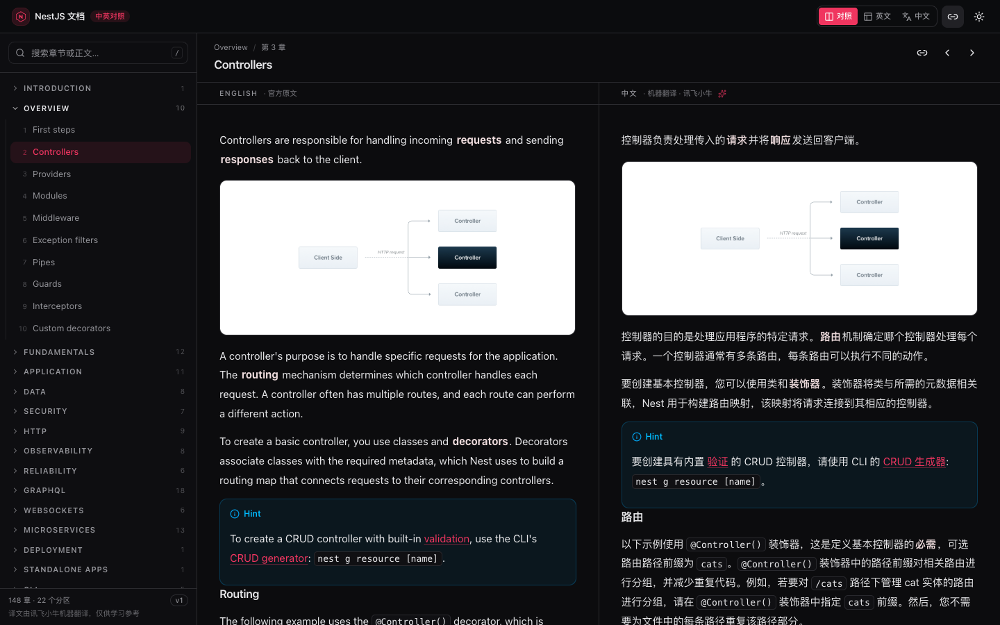
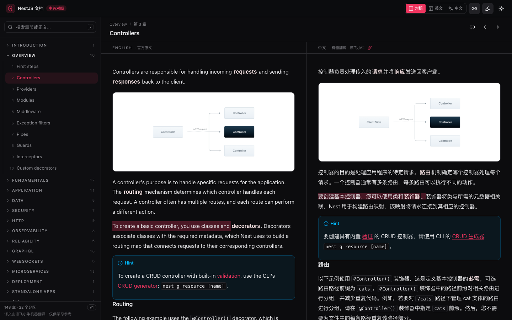
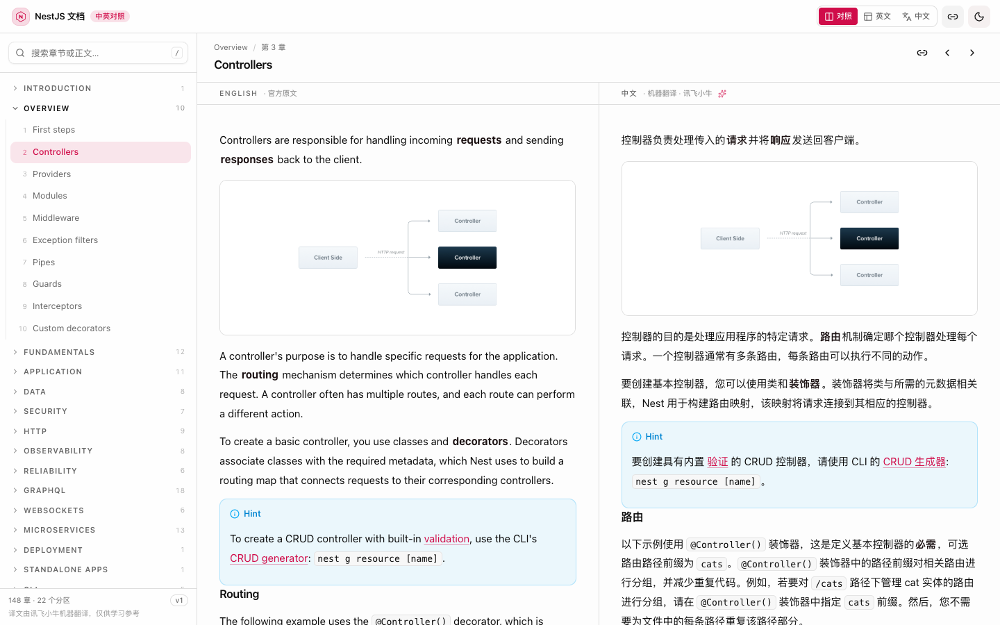
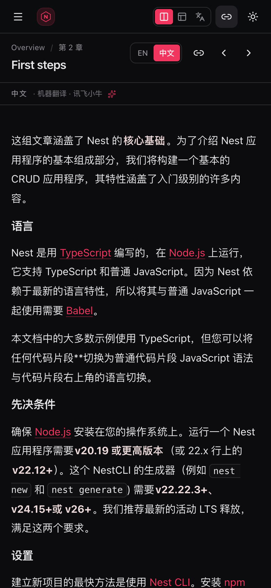

# NestJS 文档 · 中英对照阅读器

把 NestJS 官方文档做成本地可离线阅读的双栏应用：**左边英文原文，右边中文译文，滚动按块同步**。



## 功能

- **块级同步滚动**：按「视口顶部第一个块」对齐，中英文长度差异不会累积成错位，可一键关闭
- **划词联动高亮**：选中一侧的句子，另一侧对应句子自动高亮（段落按句子对齐，列表/表格按项/单元格对齐）
- **三种视图**：左右对照 / 只看英文 / 只看中文（窄屏自动变成 EN·中文 两个 tab）
- **22 个分区、148 章**：侧边栏按分区折叠，当前章节高亮
- **全文搜索**：`⌘K` 或 `/` 唤起，命中标题或正文，结果带高亮片段
- **阅读体验**：深/浅色主题、代码高亮、提示框、表格、`<details>` 折叠块、官网目录树样式
- **链接处理**：站内 `/controllers` 这类链接改写成应用内路由；外链新窗口打开
- **阅读进度**：按章记住滚动位置（锚点块 + 偏移 + 比例），刷新/重开自动回到原处；侧边栏有「继续阅读」和每章百分比
- **记忆偏好**：上次读的章节、主题、视图模式（localStorage）
- **移动端**：抽屉式目录 + 单栏切换，适配 390px 宽度

| 划词联动 | 浅色 |
| --- | --- |
|  |  |



## 快速开始

```bash
cd nest-api-zh/app
pnpm install
pnpm dev          # 启动前会自动同步数据
```

打开终端提示的地址（默认 http://localhost:5173）。

生产构建：

```bash
pnpm build        # tsc --noEmit + vite build
pnpm preview
```

> `dev`/`build` 之前会自动执行 `scripts/sync-data.mjs`，把 `../docs/nestjs-docs-20261026.zh.json` 复制成 `public/data/nestjs-docs.json`（该文件不进 git，6.8 MB）。

## 数据从哪来

```
nest-api-zh/
├── docs/
│   ├── nestjs-docs-20261026.json       英文原文（抓虫脚本产物）
│   └── nestjs-docs-20261026.zh.json    加了 zh 字段的译文  ← app 用这份
├── tools/
│   ├── translate_xfyun.py              讯飞小牛翻译（代码保护 + 缓存 + 断点续跑）
│   ├── polish_zh.py                    术语统一 / 中英间距 / 链接间距
│   └── verify_zh.py                    结构验收（代码块、链接、表格）
└── app/                                ← 本应用
```

翻译更新后：

```bash
cd nest-api-zh
python3 tools/translate_xfyun.py     # 增量翻译；全命中缓存时 0 次调用
python3 tools/polish_zh.py           # 建议每次都跑，保持术语与排版一致
cd app && pnpm dev                   # 启动时自动同步数据
```

## 目录结构

```
src/
├── App.tsx                    路由（hash）、加载态、快捷键
├── components/
│   ├── top-bar.tsx            视图模式 / 同步开关 / 主题
│   ├── sidebar.tsx            分区目录 + 搜索
│   ├── reader.tsx             双栏 + 同步滚动 + 上下章
│   ├── block-view.tsx         单块渲染（标题/段落/代码/提示框/表格…）
│   └── ui/                    shadcn 风格组件（Radix 原语）
├── hooks/
│   ├── use-scroll-sync.ts     块级滚动同步
│   └── use-theme.ts           主题持久化
└── lib/
    ├── data.ts                加载、扁平化、路由解析、搜索索引
    ├── markdown.ts            markdown-it + highlight.js，链接改写
    ├── types.ts               数据模型
    └── utils.ts               cn() / slug
```

## 划词联动是怎么做的

浏览器没有“翻译对齐”信息，所以对齐是算出来的：

1. **切句**：`Intl.Segmenter`（en / zh）把段落切成句子；
2. **对齐**：按两侧总字数的比例做单调 DP，允许 1:1、2 英:1 中、1 英:2 中，代价是长度占比差（机翻基本保持句序，所以效果稳定）；
3. **高亮**：`CSS Custom Highlight API`（`CSS.highlights` + `::highlight(nest-linked)`）直接在另一侧建 `Range`，**不改 DOM、不触发 React 重渲染**；
4. **特例**：列表按 `<li>` 序号、表格按单元格序号一一对应（翻译时就是逐项/逐格翻的，天然对齐）；代码块整块高亮；图片/分割线不映射。

实现见 `src/lib/selection-link.ts` + `src/hooks/use-linked-selection.ts`。

## 阅读进度是怎么存的

每次滚动后（700ms 节流）记录三项：`{ bid: 视口第一个块的 id, delta: 该块顶部到视口顶部的偏移, ratio: 滚动比例 }`。

恢复时优先用 `bid + delta` 精确定位（布局变化也能对上），找不到块再退回 `ratio * (scrollHeight - clientHeight)`；恢复后调用一次同步滚动，让右栏跟着对齐。关闭页面前用 `pagehide` / `visibilitychange` 再存一次，避免防抖窗口内丢数据。

## 快捷键

| 键 | 作用 |
| --- | --- |
| `/` 或 `⌘K` | 聚焦搜索 |
| `Alt` + `←` / `→` | 上一章 / 下一章 |
| `Esc` | 关闭搜索（在输入框内） |

## 技术栈

Vite 8 · React 19 · TypeScript · Tailwind CSS v4 · shadcn 风格组件（Radix UI）· markdown-it · highlight.js

## 已知限制

- 译文是**机器翻译**（讯飞小牛），术语已做保护（代码、类名、URL 不翻），但语感仍偏机翻；发现译错可直接改 `docs/nestjs-docs-20261026.zh.json` 里的 `zh` 字段，重新 `pnpm dev` 即可 —— 翻译脚本默认跳过已有 `zh`，不会覆盖你的修改。
- 正文里的 HTML 是官方原文自带的（如 `file-tree` 目录树），直接渲染，未做额外清洗。
