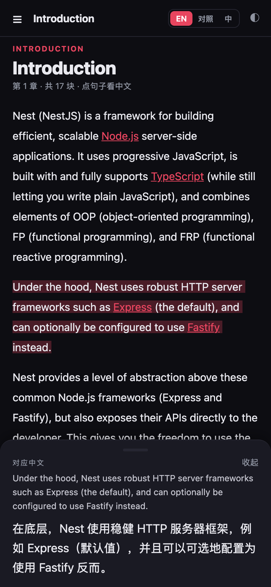
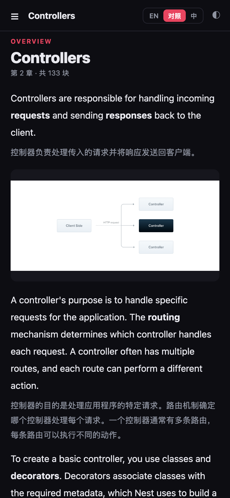
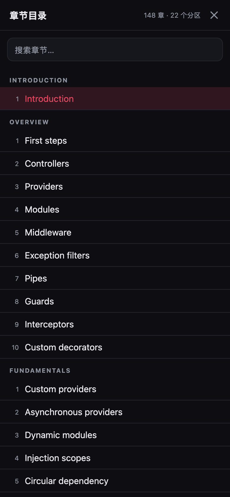
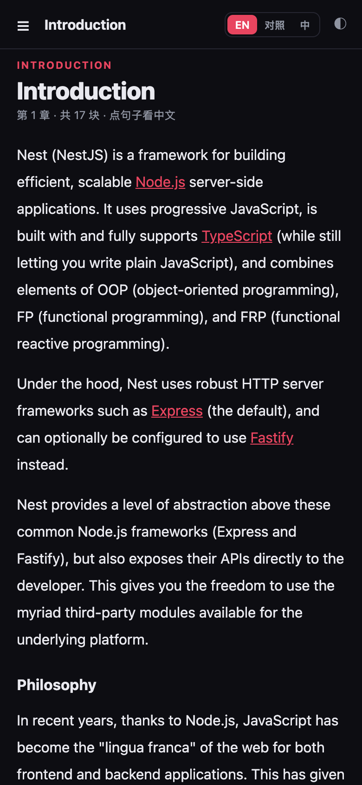
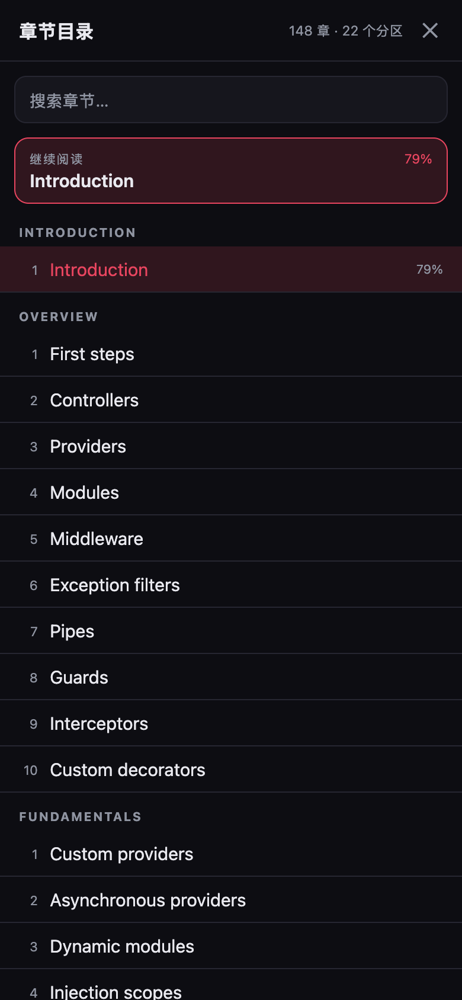

# NestJS 文档 · 手机版（React Native / Expo）

英文原文优先，**点句子看中文**。专为小屏设计，不硬塞双栏。

| 点句翻译 | 逐段对照 |
| --- | --- |
|  |  |

| 章节抽屉 | 纯英文阅读 |
| --- | --- |
|  |  |

## 为什么这样设计

手机宽度只有 390pt，左右分栏每栏不到 190pt，英文一行断三四个词，中文更惨。所以换成「按需翻译」：

| 方案 | 问题 / 结论 |
| --- | --- |
| 左右双栏 | 手机上不可读，否决 |
| EN / 中 整页切换 | 上下文断了，来回切很累 |
| **逐段上下对照** | 保留上下文，但滚动长度翻倍 → 作为可选模式「对照」 |
| **点句子看中文**（默认） | 阅读不被打断，只在需要时展开 → 主模式 |
| 点单词 | 需要把每个词拆成独立 `<Text>`，布局与性能都变差；句子才是翻译对齐的最小可靠单位 |

所以提供三种模式（顶栏切换，记住选择）：

- **EN**：纯英文，点任意句子 → 该句高亮 + 底部弹出对应中文
- **对照**：英文段落后紧跟浅色中文，适合精读
- **中**：纯中文

## 功能

- 148 章按需加载（`require` 单章 JSON，不一次性解析 6.8 MB）
- 章节抽屉：22 个分区 + 搜索
- 句子级对齐：`Intl.Segmenter` 切句 + 长度比例 DP，和 Web 版同一套算法
- 列表按项、表格按单元格一一对应（翻译时就是逐项/逐格翻的）
- **阅读进度**：按章记住滚动位置，重开 App 自动回到原处；抽屉里有「继续阅读」和每章百分比
- 深/浅色主题、记住上次章节与模式
- 代码块横向滚动、表格横向滚动

## 运行

```bash
cd nest-api-zh/mobile
npm install
npm run sync:data     # 由 docs/*.zh.json 拆出 assets/data
npm start             # 手机装 Expo Go 扫码
```

其他：

```bash
npm run web           # 浏览器里预览（开发用）
npm run ios           # iOS 模拟器
npm run android       # Android 模拟器
npm run typecheck
```

## 阅读进度（历史缓存）

关掉 App 再打开不会回到页首：

- 每章独立记录 `{ 比例, 像素位置, 时间戳 }`，存在设备的 AsyncStorage；
- 滚动时每 0.8 秒记一次，**切后台/退出前立即落盘**；
- 恢复时优先按**比例**换算（换字号、换设备尺寸也不会偏太多），内容布局完成后再滚，避免"滚了但内容还没渲染"；
- 章节抽屉顶部有「继续阅读」卡片，列表里显示已读百分比。



## 装到真机 iPhone

前置：Xcode 已登录 Apple ID（Settings → Accounts）、数据线连接并「信任此电脑」。

```bash
npm run ios:device          # = bash scripts/install-ios.sh
# 指定设备：
bash scripts/install-ios.sh <UDID>
# 查 UDID：
xcrun devicectl list devices
```

脚本做的事：`expo prebuild`（没有 ios/ 时）→ `pod install` → `xcodebuild -allowProvisioningUpdates` 自动签名 → `devicectl install` → 启动。

### 关于复用已有证书和 profile

- **证书可以复用**：`Apple Development` 证书绑定的是 Team（这里是 `9B99Q22WDJ`），对所有 App 通用。
- **旧的描述文件不能直接复用**：它绑死了 Bundle ID（你之前那个是 `com.yangzheng.certgen`），且包含指定设备。给新 App 用会签名失败。
- 正确做法就是现在这样：**复用证书 + Team，让 Xcode 为新的 Bundle ID 自动生成 profile**（这一步需要 `-allowProvisioningUpdates`，脚本已带）。
- 如果要把 App 换成旧 Bundle ID 去套旧 profile，会覆盖手机上同 ID 的另一个 App，不建议。

当前自动生成的 profile：`9B99Q22WDJ.com.yangzheng.nestdocs`，有效期 **7 天**（免费 Apple ID 的限制：最多 3 个 App、7 天需重签）。

### 7 天后过期怎么办

直接重跑 `npm run ios:device`：profile 会自动续，增量编译通常 1–2 分钟。想要 1 年有效期只能加入 Apple Developer Program（付费账号），或用 TestFlight。

## 数据

```
../docs/nestjs-docs-20261026.zh.json
        │ npm run sync:data
        ▼
assets/data/index.json          ← 目录（39 KB，启动即用）
assets/data/chapters/<slug>.json ← 148 个按章 JSON，点开才加载
```

`assets/data` 不进 git（见 `.gitignore`），换机器跑一次 `npm run sync:data` 即可。

## 结构

```
App.tsx                     主题/安全区/章节切换
src/
├── theme.tsx               深色 + 浅色两套 palette，AsyncStorage 记忆
├── lib/
│   ├── data.ts             目录、按章加载、上一章/下一章
│   ├── markdown.ts         行内解析（加粗/行内代码/链接）、列表、表格
│   └── align.ts            切句 + DP 对齐（Web 版同款）
└── components/
    ├── header.tsx          目录按钮 / 标题 / 三模式切换 / 主题
    ├── chapter-drawer.tsx  全屏目录 + 搜索
    ├── chapter-view.tsx    正文 + 上下章
    ├── block.tsx           各类块渲染 + 句子可点
    └── translation-sheet.tsx 底部译文卡
```

## 已知限制

- 点的是句子，不是单词（单词级需要逐词拆 `<Text>`，会明显拖慢长文渲染）。
- 译文卡从底部弹出，可能盖住刚点的句子；后续可以「弹出前把该句滚到上半屏」。
- 代码块是等宽纯文本，还没有语法高亮（可接 `react-native-syntax-highlighter`）。
- 图片固定高度 `190`、`contain` 展示，长图会留白。
- 表格固定列宽 170，超宽需横向滑动。
